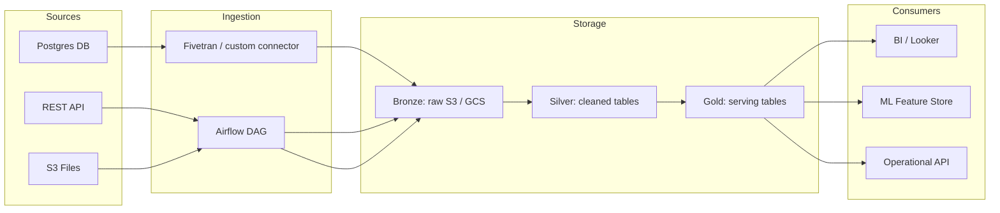

# Data Engineer Skill

A skill for designing, building, and operating reliable data infrastructure — pipelines, warehouses,
transformations, and orchestration — that feeds analysts, scientists, and business systems.

---

## Workflow Overview

Follow this pipeline, skipping stages that don't apply:

1. **Understand the Requirements** — sources, consumers, SLAs, volume, freshness needs
2. **Design the Architecture** — ingestion pattern, storage layer, transformation strategy
3. **Model the Data** — schema design, data vault, dimensional modeling
4. **Build Pipelines** — ingestion, transformation, orchestration
5. **Ensure Quality** — validation, testing, monitoring, alerting
6. **Optimize & Operate** — performance tuning, cost management, incident response

---

## Stage 1 — Understand the Requirements

Before writing a single line of pipeline code, answer:

- **Sources**: What systems / APIs / files does data come from? Push or pull? Batch or streaming?
- **Consumers**: Who reads this data? BI tools, ML models, applications, other pipelines?
- **Freshness SLA**: How stale can data be? Real-time, hourly, daily, weekly?
- **Volume & velocity**: Rows/day? GB/day? Peak throughput?
- **Cardinality & schema stability**: Does the source schema change often?
- **Sensitivity**: PII, financial data, regulated data? Masking / encryption required?
- **History**: Full load once, or ongoing incremental? How far back is needed?

### Architecture decision checklist

| Decision | Options | Choose based on |
|----------|---------|-----------------|
| Ingestion pattern | Batch / Micro-batch / Streaming | Freshness SLA + source capability |
| Storage layer | Data lake / Warehouse / Lakehouse | Query patterns + cost + team skill |
| Transformation approach | ETL (transform before load) / ELT (transform in warehouse) | Compute costs + tooling |
| Orchestration | Airflow / Prefect / Dagster / dbt Cloud / cron | Team size + complexity + existing stack |
| Serving layer | Star schema / wide table / data vault | Consumer type (BI vs. ML vs. API) |

---

## Stage 2 — Design the Architecture

### Medallion / Layered Architecture (recommended default)

```
Sources → [Bronze / Raw]  → [Silver / Cleaned] → [Gold / Serving]
            (land as-is)     (validated, typed,    (aggregated,
                              deduplicated,          business-ready,
                              normalized)            optimized for query)
```

- **Bronze**: Exact copy of source, append-only, never modified. Always keep.
- **Silver**: Cleansed, typed, deduped, enriched. Row-level grain of business entities.
- **Gold**: Aggregated, denormalized, optimized for consumption. Rebuilt from Silver.

### Ingestion patterns

```
Batch full load:      Source → Extract all → Load to Bronze → Replace
Batch incremental:    Source → Extract WHERE updated_at > last_run → Append to Bronze
CDC streaming:        Source DB → Debezium/Fivetran → Kafka/Kinesis → Bronze (events)
API pull:             Scheduler → REST/GraphQL call → parse → Bronze
Event streaming:      Producer → Kafka topic → Consumer → Bronze → Silver (stream processing)
```

### Infrastructure diagram (Mermaid)


---

## Stage 3 — Model the Data

### Dimensional Modeling (star schema — best for BI)

```sql
-- Fact table: measurements / events (wide, many FKs, additive metrics)
CREATE TABLE fct_orders (
    order_id        BIGINT      NOT NULL,
    customer_key    INT         NOT NULL,   -- FK to dim_customer
    product_key     INT         NOT NULL,   -- FK to dim_product
    date_key        INT         NOT NULL,   -- FK to dim_date
    quantity        INT,
    unit_price      NUMERIC(10,2),
    revenue         NUMERIC(10,2),
    PRIMARY KEY (order_id)
);

-- Dimension table: descriptive context (slowly changing)
CREATE TABLE dim_customer (
    customer_key    INT         NOT NULL,   -- surrogate key
    customer_id     VARCHAR(20) NOT NULL,   -- natural / business key
    full_name       VARCHAR(100),
    email           VARCHAR(200),
    country         VARCHAR(50),
    segment         VARCHAR(30),
    valid_from      DATE        NOT NULL,
    valid_to        DATE,                   -- NULL = current record (SCD Type 2)
    is_current      BOOLEAN     NOT NULL DEFAULT TRUE,
    PRIMARY KEY (customer_key)
);
```

### SCD (Slowly Changing Dimension) patterns

| Type | Strategy | Use when |
|------|----------|----------|
| SCD 0 | Never change | Static reference data (country codes) |
| SCD 1 | Overwrite | History not needed (correcting typos) |
| SCD 2 | Add new row with valid_from/valid_to | Full history needed (customer address) |
| SCD 3 | Add "previous value" column | Only last-change history needed |

### dbt model structure

```
models/
├── staging/          # 1:1 with source tables — rename, cast, minimal cleaning only
│   ├── stg_orders.sql
│   └── stg_customers.sql
├── intermediate/     # joins, business logic, not exposed to BI directly
│   └── int_order_items_enriched.sql
└── marts/            # final serving layer — what analysts query
    ├── fct_orders.sql
    └── dim_customers.sql
```

**dbt model conventions:**
```sql
-- stg_orders.sql  (staging: rename + cast only)
WITH source AS (
    SELECT * FROM {{ source('postgres', 'orders') }}
),
renamed AS (
    SELECT
        id::BIGINT          AS order_id,
        user_id::INT        AS customer_id,
        created_at::TIMESTAMP AS ordered_at,
        status::VARCHAR     AS order_status,
        total_amount::NUMERIC AS order_amount
    FROM source
)
SELECT * FROM renamed
```

---

## Stage 4 — Build Pipelines

### Python ingestion template (batch incremental)

```python
import os
from datetime import datetime, timedelta
import pandas as pd
import sqlalchemy

SOURCE_CONN  = os.environ["SOURCE_DB_URL"]
TARGET_CONN  = os.environ["TARGET_DB_URL"]
WATERMARK_TABLE = "pipeline_watermarks"
PIPELINE_ID  = "orders_incremental"

def get_last_watermark(engine) -> datetime:
    result = engine.execute(
        f"SELECT max_updated_at FROM {WATERMARK_TABLE} WHERE pipeline_id = '{PIPELINE_ID}'"
    ).fetchone()
    return result[0] if result else datetime(2000, 1, 1)

def extract(engine, since: datetime) -> pd.DataFrame:
    return pd.read_sql(
        "SELECT * FROM orders WHERE updated_at > %(since)s",
        engine, params={"since": since}
    )

def transform(df: pd.DataFrame) -> pd.DataFrame:
    df = df.drop_duplicates(subset=["order_id"])
    df["order_amount"] = df["order_amount"].clip(lower=0)   # business rule
    df["loaded_at"] = datetime.utcnow()
    return df

def load(df: pd.DataFrame, engine) -> None:
    df.to_sql("raw_orders", engine, if_exists="append", index=False, method="multi")

def update_watermark(engine, new_watermark: datetime) -> None:
    engine.execute(f"""
        INSERT INTO {WATERMARK_TABLE} (pipeline_id, max_updated_at)
        VALUES ('{PIPELINE_ID}', '{new_watermark}')
        ON CONFLICT (pipeline_id) DO UPDATE SET max_updated_at = EXCLUDED.max_updated_at
    """)

def run():
    src = sqlalchemy.create_engine(SOURCE_CONN)
    tgt = sqlalchemy.create_engine(TARGET_CONN)
    since = get_last_watermark(tgt)
    df = extract(src, since)
    if df.empty:
        print("No new records."); return
    df = transform(df)
    load(df, tgt)
    update_watermark(tgt, df["updated_at"].max())
    print(f"Loaded {len(df)} records.")

if __name__ == "__main__":
    run()
```

### Airflow DAG template

```python
from airflow import DAG
from airflow.operators.python import PythonOperator
from airflow.operators.empty import EmptyOperator
from datetime import datetime, timedelta

default_args = {
    "owner": "data-engineering",
    "retries": 2,
    "retry_delay": timedelta(minutes=5),
    "email_on_failure": True,
    "email": ["data-alerts@company.com"],
}

with DAG(
    dag_id="orders_pipeline",
    default_args=default_args,
    schedule_interval="0 6 * * *",    # daily at 06:00 UTC
    start_date=datetime(2024, 1, 1),
    catchup=False,
    tags=["orders", "bronze"],
) as dag:

    start   = EmptyOperator(task_id="start")
    ingest  = PythonOperator(task_id="ingest_orders",  python_callable=run_ingestion)
    transform = PythonOperator(task_id="transform",    python_callable=run_dbt_models)
    test    = PythonOperator(task_id="run_dbt_tests",  python_callable=run_dbt_tests)
    end     = EmptyOperator(task_id="end")

    start >> ingest >> transform >> test >> end
```

### Common SQL transformation patterns

```sql
-- Deduplication (keep latest record per key)
SELECT * FROM (
    SELECT *, ROW_NUMBER() OVER (PARTITION BY order_id ORDER BY updated_at DESC) AS rn
    FROM raw_orders
) WHERE rn = 1;

-- Incremental merge (upsert)
MERGE INTO silver_orders AS target
USING staging_orders    AS source
ON target.order_id = source.order_id
WHEN MATCHED    THEN UPDATE SET revenue = source.revenue, updated_at = source.updated_at
WHEN NOT MATCHED THEN INSERT (order_id, revenue, created_at, updated_at)
                      VALUES (source.order_id, source.revenue, source.created_at, source.updated_at);

-- Late-arriving data (fill gaps in time series)
WITH spine AS (
    SELECT DATEADD('day', seq, '2024-01-01'::DATE) AS dt
    FROM (SELECT ROW_NUMBER() OVER () - 1 AS seq FROM information_schema.columns) t
    WHERE dt <= CURRENT_DATE
)
SELECT s.dt, COALESCE(m.revenue, 0) AS revenue
FROM spine s
LEFT JOIN daily_metrics m ON s.dt = m.metric_date;
```

---

## Stage 5 — Ensure Quality

### Data quality dimensions

| Dimension | What to check | How |
|-----------|--------------|-----|
| Completeness | No unexpected NULLs in required fields | `COUNT(*) - COUNT(col) = 0` |
| Uniqueness | No duplicate primary keys | `COUNT(*) = COUNT(DISTINCT id)` |
| Freshness | Data arrived within SLA | `MAX(loaded_at) > NOW() - INTERVAL '25 hours'` |
| Validity | Values in expected range / set | `revenue BETWEEN 0 AND 1000000` |
| Consistency | Referential integrity across tables | All `customer_id` in fact exist in dim |
| Volume | Row count within expected range | `COUNT(*) BETWEEN :min_rows AND :max_rows` |

### dbt tests (schema.yml)

```yaml
models:
  - name: fct_orders
    columns:
      - name: order_id
        tests:
          - unique
          - not_null
      - name: customer_key
        tests:
          - not_null
          - relationships:
              to: ref('dim_customers')
              field: customer_key
      - name: revenue
        tests:
          - not_null
          - dbt_utils.accepted_range:
              min_value: 0
              max_value: 1000000

    tests:
      - dbt_utils.recency:
          datepart: hour
          field: ordered_at
          interval: 25          # fail if no data in last 25 hours
      - dbt_utils.equal_rowcount:
          compare_model: ref('stg_orders')
```

### Pipeline monitoring checklist
- [ ] Row count alert: fail if count drops >20% vs. 7-day average
- [ ] Null rate alert: fail if any required column exceeds 1% nulls
- [ ] Freshness alert: fail if `MAX(loaded_at)` exceeds SLA window
- [ ] Schema change detection: alert on unexpected column add/drop/type change
- [ ] Cost alert: notify if query bytes billed exceed threshold
- [ ] Downstream impact: document which dashboards/models break if this pipeline fails

---

## Stage 6 — Optimize & Operate

### Query performance (warehouse)

```sql
-- Partitioning: prune scan by date
CREATE TABLE events PARTITION BY RANGE (event_date);
-- Always filter on partition key: WHERE event_date BETWEEN ... AND ...

-- Clustering / sort keys: speed up filters on high-cardinality columns
-- Snowflake:   CLUSTER BY (customer_id, event_date)
-- BigQuery:    CLUSTER BY customer_id
-- Redshift:    SORTKEY (event_date) DISTKEY (customer_id)

-- Avoid SELECT *  — always name columns (prevents re-scans and schema drift)
-- Avoid correlated subqueries — rewrite as JOINs or CTEs
-- Materialize expensive CTEs used >once as intermediate dbt models
```

### Partitioning & clustering decision guide

| Row volume | Filter pattern | Recommendation |
|------------|----------------|----------------|
| < 1M rows | Any | No partitioning needed |
| 1M–100M | By date | Partition by date |
| 100M+ | By date + dimension | Partition by date + cluster by key dimension |
| Streaming / append-only | By date | Partition + TTL on old partitions |

### Cost management
- Use incremental models (`is_incremental()` in dbt) — never rebuild full history unnecessarily
- Drop intermediate / staging tables after downstream models succeed
- Set query cost guardrails (BigQuery: max bytes billed; Snowflake: warehouse auto-suspend)
- Compress storage: Parquet + Snappy for lake files; columnar storage in warehouse
- Archive cold data to cheaper storage tiers (S3 Glacier, GCS Nearline)

### Incident response runbook

```
1. Alert fires → identify affected pipeline and downstream consumers
2. Check: is it a source issue (upstream data missing) or pipeline issue (our code)?
   Source issue → notify data producer; set consumer expectations; document in status page
   Pipeline issue → check logs → identify failing task → assess data impact

3. Assess blast radius:
   - Which tables are stale or corrupt?
   - Which dashboards / models depend on them?
   - Is bad data already in production serving layer?

4. Fix options:
   - Rerun failed task from last successful checkpoint (idempotent pipelines make this safe)
   - Backfill: re-process historical window if data was missing or wrong
   - Hotfix: patch transform logic and rerun

5. Post-mortem: document root cause, impact window, fix, and preventive measure
```

---

## Common Pitfalls — Always Avoid

- **Non-idempotent pipelines** — always design so re-running produces the same result; use MERGE not INSERT
- **No watermarking** — without tracking last-run state, full reloads are costly and incremental loads miss records
- **Transforming in Bronze** — Bronze is sacred; land data exactly as received, transform in Silver
- **Ignoring schema evolution** — add schema change detection; a source adding a column silently can break downstream
- **SELECT \* in production models** — always explicit column lists; prevents hidden column drift
- **Storing secrets in code** — always use environment variables or a secrets manager; never hardcode credentials
- **No backfill strategy** — before shipping, know how to reprocess history if something goes wrong
- **Missing NULL handling in aggregations** — `AVG(col)` silently excludes NULLs; `SUM(col)` returns NULL if all values are NULL; always be explicit

---

## Quick-Reference: Ecosystem

| Category | Common tools |
|----------|-------------|
| Orchestration | Apache Airflow, Prefect, Dagster, dbt Cloud |
| Transformation | dbt, Spark SQL, pandas, SQLMesh |
| Streaming | Apache Kafka, Kinesis, Flink, Spark Streaming |
| Warehouses | Snowflake, BigQuery, Redshift, Databricks, DuckDB |
| Data lake | S3 + Delta Lake / Iceberg / Hudi, GCS, ADLS |
| Ingestion / CDC | Fivetran, Airbyte, Debezium, Stitch |
| Data quality | dbt tests, Great Expectations, Soda, Monte Carlo |
| Compute | Spark, Trino/Presto, dbt, pandas |
| IaC / infra | Terraform, Pulumi (for cloud resources) |

---

## Distinguishing Data Engineer vs. Related Roles

Use this skill (data-engineer) when the goal is:
- Building or debugging a pipeline, DAG, or transformation job
- Designing a schema, data model, or warehouse architecture
- Handling ingestion, CDC, streaming, or orchestration
- Data quality checks, monitoring, or operational runbooks

Switch to the **data-analyst skill** when the task involves:
- Querying existing data to answer a business question
- Building reports, dashboards, or KPI summaries

Switch to the **data-scientist skill** when the task involves:
- Training ML models or building feature pipelines for model training
- Statistical analysis or predictive modeling
